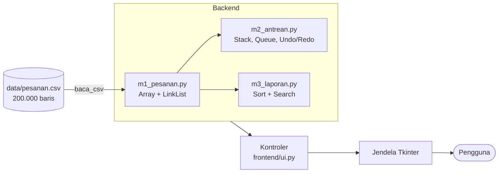

# 2EZ4U: Engine Backend Layanan Antar Makanan

Proyek akhir **Struktur Data & Analisa Algoritma (EC234303)**, Departemen Teknik Komputer, FTEIC-ITS.
Mini engine backend layanan antar makanan seperti GoFood, GrabFood, dan ShopeeFood: pesanan masuk, diantre, dihitung di kasir, dilaporkan, dan dicari, semuanya dengan struktur data dan algoritma yang ditulis sendiri.

Aturan proyek: tanpa `dict`, `set`, `sorted`, `.sort()`, `heapq`, `bisect`, `collections`, literal `{}`, maupun comprehension dict/set. Yang dipakai hanya `list` sebagai larik primitif, tuple, class biasa, aritmetika, dan I/O.

Data uji: `data/pesanan.csv` (200.000 pesanan).

> Nama / NRP: _Luna Calista Azalia Zahra / 5024251112_

## Struktur Repo

```
2ez4u/
├── backend/
│   ├── m1_pesanan.py     # M1: Array dinamis vs Linked List
│   ├── m2_antrean.py     # M2: Stack, Queue (naif vs melingkar), Undo/Redo, kasir postfix
│   └── m3_laporan.py     # M3: Insertion sort, merge sort, linear search, binary search
├── data/
│   └── pesanan.csv       # 200.000 baris pesanan
├── frontend/
│   └── ui.py             # UI Tkinter: menu, form, tabel hasil, panel COMMAND
├── app.py                # titik masuk aplikasi
└── README.md
```

## Cara Menjalankan

Butuh **Python 3.11 ke atas** dengan Tkinter (bawaan Python; di Windows centang *tcl/tk and IDLE* saat instalasi). Tidak ada library tambahan.

```
python app.py
```

Jalankan dari root repo. Klik **Load** lebih dulu untuk memuat `data/pesanan.csv`, lalu pilih menu di kiri. Setiap perintah dicatat di panel **COMMAND** beserta modul dan waktunya.

Setiap modul backend juga bisa dijalankan sendiri untuk pemeriksaan cepat:

```
python backend/m1_pesanan.py data/pesanan.csv   # memuat CSV, mencetak jumlah dan waktunya
python backend/m2_antrean.py                    # demo kasir postfix dan undo/redo
python backend/m3_laporan.py                    # demo sort (stabil) dan search
```

## Diagram



`Kontroler` tidak memakai Tkinter sama sekali, jadi seluruh alur backend bisa dijalankan tanpa jendela. `AplikasiUI` hanya menampilkan hasil dan waktunya.

## Menu Aplikasi

| Grup | Menu |
|---|---|
| DATA | Load |
| M1 | Array dan Linked List: lihat, tambah REGULER, tambah PRIORITAS, tambah VIP, hapus |
| M2 | Stack postfix (mesin kasir), undo, redo, enqueue, dequeue naif, dequeue circular |
| M3 | Insertion sort, merge sort, linear search, binary search |

## M1: Data Pesanan (Array vs Linked List)

Pesanan disimpan di dua struktur sekaligus agar performanya bisa diadu langsung:

- **Array dinamis**: kapasitas dilipatduakan saat penuh (append O(1) amortized), sisip dan hapus menggeser elemen (O(n)).
- **Linked List** dengan penunjuk `head` dan `tail`: tambah di depan dan belakang O(1), sisip dan hapus di tengah harus menelusuri (O(n)).

Aturan bisnis penyisipan:

| Jenis | Prioritas | Posisi masuk |
|---|---|---|
| REGULER | 3 | paling belakang |
| PRIORITAS | 2 | tengah barisan (`size // 2`) |
| VIP | 1 | paling depan |

Hasil pengukuran pada 200.000 baris (ms, rata-rata 5 kali):

| Operasi | Array | Linked List | Penyebab |
|---|---|---|---|
| Lihat tengah | 0,0028 | 2,0825 | Array langsung loncat ke indeks, Linked List menelusuri dari `head` |
| Tambah REGULER | 0,0026 | 0,0011 | Keduanya hanya menempel di belakang |
| Tambah PRIORITAS | 5,2754 | 2,0224 | Array menggeser separuh isi, Linked List menelusuri separuh lalu menyambung |
| Tambah VIP | 10,1792 | 0,0056 | Array menggeser seluruh isi, Linked List hanya mengubah satu penunjuk |
| Hapus tengah | 5,1531 | 1,8657 | Sama seperti PRIORITAS |

Memuat 200.000 baris: Array 46,26 ms, Linked List 105,46 ms (Linked List harus membuat 200.000 simpul).

## M2: Stack dan Queue

### Kasir (Stack)

Struk infix diubah ke postfix memakai stack operator, lalu dievaluasi memakai stack nilai. Operand **kanan** di-pop lebih dulu supaya `-` dan `/` benar.

Contoh: `( 3 * 12000 ) + ( 2 * 8500 ) - 5000` menjadi `3 12000 * 2 8500 * + 5000 -` dengan total **Rp 48.000**. UI menampilkan kedua tahap sebagai satu tabel langkah (baris `1.x` konversi, `2.x` evaluasi).

Ekspresi yang salah ditolak dengan pesan yang jelas: kurung tidak berpasangan, dua angka berurutan tanpa operator (`2 3 +`), operator tanpa operand, ekspresi kosong, karakter asing, dan pembagian dengan nol.

### Antrean: naif vs melingkar

Dua versi diisi data yang sama persis (pesanan berstatus ANTRE):

- **Naif**: `dequeue` mengambil indeks 0 lalu menggeser seluruh sisa isi, O(n).
- **Melingkar**: `dequeue` hanya memajukan penunjuk `front`, O(1).

Keputusan desain antrean melingkar:

- Saat penuh, kapasitas **tumbuh 2x** (enqueue tidak pernah ditolak).
- Kosong atau penuh dibedakan dengan pencacah `count`, karena `front == rear` bisa berarti keduanya.
- `dequeue` saat kosong mengembalikan `None`.

### Undo dan Redo

Dua stack. Setiap aksi didorong ke stack undo bersama data yang cukup untuk membalikkannya:

| Aksi yang tercatat | Kebalikannya saat undo |
|---|---|
| ENQUEUE pesanan | keluarkan lagi pesanan itu dari belakang antrean |
| DEQUEUE daftar pesanan | kembalikan seluruh daftar ke **depan** antrean, urutan asli terjaga |

- Yang dicatat untuk DEQUEUE adalah **daftar pesanannya**, bukan hitungannya.
- `redo` mengerjakan ulang aksi aslinya, bukan kebalikannya.
- Aksi baru apa pun mengosongkan stack redo.
- Di UI, dequeue naif dan dequeue circular adalah dua menu terpisah dengan catatan undo masing-masing, sehingga isi kedua antrean bisa berbeda sementara sampai aksinya dibatalkan atau diulang.
- Untuk dequeue gabungan di backend (`ManajerUndoRedo.dequeue`), undo dan redo hanya menyentuh antrean melingkar. Antrean naif ditandai "basi" dan disalin ulang dari yang melingkar saat dibutuhkan, di luar hitungan waktu undo.

Hasil pengukuran pada 19.850 pesanan berstatus ANTRE:

| Dequeue n | Naif (ms) | Melingkar (ms) | Geseran naif | Geseran melingkar |
|---|---|---|---|---|
| 1 | 3,2359 | 0,0142 | 19.849 | 0 |
| 10 | 37,9523 | 0,0151 | 198.445 | 0 |
| 100 | 503,6577 | 0,0928 | 1.979.950 | 0 |
| 1000 | 2470,0280 | 0,4212 | 19.349.500 | 0 |

Enqueue 1 pesanan hampir sama murahnya di keduanya (naif 0,0037 ms, melingkar 0,0010 ms). Undo dequeue 100 pesanan: 0,0752 ms, redo: 0,0522 ms. Seluruh selisih muncul di `dequeue`, bukan `enqueue`.

## M3: Sort dan Search

Setiap algoritma melaporkan **jumlah perbandingan** lewat objek `Pencacah`, bukan hanya waktu, karena jumlah perbandingan sama di komputer mana pun.

| Algoritma | Kompleksitas | Catatan |
|---|---|---|
| Insertion sort | O(n²) | Stabil (menggeser hanya bila `>`), di tempat; menolak data di atas 20.000 baris dengan pesan, bukan membeku |
| Merge sort | O(n log n) | Stabil (`<=` saat menggabung), mengembalikan larik baru |
| Linear search | O(n) | Tidak butuh data terurut |
| Binary search | O(log n) | Butuh data terurut menurut kunci yang dicari |

Laporan harian terurut menurut waktu selesai, jadi binary search atas `oid` memakai **daftar terpisah yang diurutkan menurut `oid`**, dibangun sekali dengan merge sort. Pesanan tanpa waktu selesai diberi kunci sangat besar sehingga selalu di paling akhir.

Sort menurut `harga`, perbandingan vs n:

| n | Insertion (cmp) | Insertion (ms) | Merge (cmp) | Merge (ms) |
|---|---|---|---|---|
| 1.000 | 233.802 | 30,33 | 8.650 | 2,12 |
| 2.000 | 962.430 | 121,78 | 19.240 | 4,53 |
| 4.000 | 3.831.520 | 556,78 | 42.355 | 9,81 |
| 8.000 | 15.058.881 | 2.702,60 | 92.616 | 37,90 |

Saat n digandakan, perbandingan insertion sort naik sekitar **4x** (kuadratik), sedangkan merge sort sekitar **2x** (n log n). Merge sort atas seluruh 200.000 baris: 3.226.139 perbandingan, 1.439,49 ms.

Search `oid` O-199999:

| Metode | Perbandingan | Waktu |
|---|---|---|
| Linear | 199.999 | 30,2430 ms |
| Binary | 17 | 0,0552 ms |

Ongkos sekali bayar membangun daftar terurut `oid`: 1.155,14 ms. Binary search baru untung bila daftarnya dicari berkali-kali.

> Waktu (ms) bergantung pada mesin dan beban saat pengukuran. Yang dinilai adalah **polanya**: jumlah perbandingan, jumlah geseran, dan rasio antar-versi. Setiap angka bisa diperiksa ulang lewat menu aplikasi.

## Screenshot dan Demo

_(isi dengan screenshot tiap menu dan tautan video demo)_

## Catatan Desain

- Tanpa `dict`/`set`: semua struktur dibangun dari `list` primitif, tuple, dan class biasa.
- Data pesanan memakai class `Pesanan` (bukan dict). CSV dibaca dengan `csv.reader` karena kolom `pelanggan` bisa mengandung koma di dalam tanda kutip.
- `Stack` dan `AntreanNaif` dibangun di atas `Array` milik M1. `AntreanMelingkar` memakai `list` primitif langsung.
- Backend tidak bergantung pada Tkinter. `Kontroler` di `frontend/ui.py` menjembatani UI dengan backend dan bisa diuji tanpa jendela.